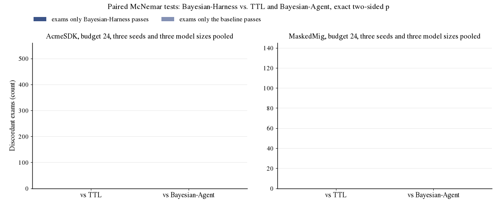

<h1 align="center">Reviewer TvTY · W2, Q4, Q5, Q6</h1>

<p align="center">
  
  
  
  
  
</p>

> [!NOTE]
> **Branch for Reviewer TvTY, weakness 2 and questions 4 to 6.** It contains every paired McNemar test quoted in the
> rebuttal, the result files they are computed from, one script that rebuilds all of them, and the low-quality-notes world
> that tests the quality variable without cheap repairs. The Oracle with back-off (W2(c), Q5) is in
> [`reviewer_zpd8/W2_oracle_backoff`](../../tree/reviewer_zpd8/W2_oracle_backoff).

## At a glance

| Reviewer's point | What this branch adds | Jump to |
|:---|:---|:---|
| **W2(b), Q4** statistical evidence is thin | paired McNemar tests over exams for Table 1 (MaskedMig) and Table 6 (AcmeSDK), ours vs. TTL and vs. Bayesian-Agent, three seeds and three model sizes pooled, plus the ablation drops | [Paired tests](#1-paired-tests-w2b-q4) |
| **W2(a), Q6** the quality variable is barely tested | a world where 35% of the notes are valid but poorly written, no cheap repair involved; quality estimated vs. frozen vs. Bayesian-Agent, with paired counts | [Quality variable](#2-the-quality-variable-w2a-q6) |
| **W2(c), Q5** the oracle is not a meaningful reference | Oracle with back-off, 3 models × 3 seeds, in its own branch | [Oracle ceiling](#3-the-oracle-ceiling-w2c-q5) |

---

## 1. Paired tests (W2(b), Q4)

> **W2(b):** *Statistical evidence on the real corpus is thin.* On MASKEDMIG the 157 tests are identical across seeds; seeds differ only in when each break is met. The reported s.d. therefore understates uncertainty [...]. Paired tests or bootstrap CIs over tests would be needed to support the "best everywhere" framing.
>
> **Q4:** For Table 1 and Table 6, can you report paired significance (e.g., McNemar or a paired bootstrap over tests) between Bayesian-Harness and the strongest baseline per column?

**Response.** We agree that the s.d. is not enough. We therefore report paired tests over exams. Within one seed both policies sit the same exams, so only exams where exactly one policy passes are informative. We count wins (ours passes, baseline fails) and losses (baseline passes, ours fails), pool the three seeds, and report the exact two-sided binomial p-value (McNemar).

**Bayesian-Harness** wins more paired exams than the baseline in every one of the `12` cells (three model sizes, two corpora, two baselines). Pooling the three model sizes per corpus, every comparison is significant.

| Pooled over 4B / 9B / 27B | wins / losses | p |
|:---|:---:|:---:|
| **Bayesian-Harness** vs TTL, AcmeSDK | 375 / 194 | `p<0.001` |
| **Bayesian-Harness** vs Bayesian-Agent, AcmeSDK | 491 / 162 | `p<0.001` |
| **Bayesian-Harness** vs TTL, MaskedMig | 120 / 48 | `p<0.001` |
| **Bayesian-Harness** vs Bayesian-Agent, MaskedMig | 94 / 48 | `p<0.001` |

<p align="center"></p>

**Ablations** (Qwen3.5-27B, AcmeSDK, budget 24, full model vs. the ablated model):

| Ablation | Subset | wins / losses | p |
|:---|:---|:---:|:---:|
| no burst recovery | all exams | 71 / 24 | `p<0.001` |
| no burst recovery | renamed drift | 38 / 9 | `p<0.001` |
| no error channel | all exams | 52 / 32 | `p=0.037` |
| no error channel | renamed drift | 25 / 10 | `p=0.017` |

The paired counts for the two largest ablation drops are significant. We will add paired counts to every ablation row and the paired tests to the revision.

<details>
<summary><strong>Which runs feed which test</strong></summary>

A paired test needs both policies on identical exams, so the inputs are:

- **AcmeSDK, budget 24.** The runs behind the paper's Table 6 (`results/acmesdk/seed*/qwen*_mb24_{ours_hhmm,ttl,bayesian_agent}.jsonl`), 346 / 343 / 330 exams for seeds 1 / 2 / 3. Keys are `(task_id, month)`.
- **MaskedMig, budget 24.** The three policies run on one inference stack so that every pair sits identical exams on identical infrastructure, 157 migrations per seed, keys `(task_id, quarter)`. The pooled counts are in `paired_pooled.csv`.
- **Ablations.** The runs behind the paper's Table 3 (`results/acmesdk/seed*/qwen27b_mb24_ours_hhmm_no_{recover,error_channel}.jsonl`).
- The renamed-drift subset uses the world truth files (`$ACMESDK_DATA/seed*/truth`), available in the datasets repository.

</details>

---

## 2. The quality variable (W2(a), Q6)

> **W2(a):** *The quality variable is barely tested in the main results.* [...] every item starts verified, so there are no low-quality-but-valid items. The internal/external distinction [...] is therefore exercised only in the separability study, where low quality is injected artificially via "cheap repairs." The direct evidence that estimating quality helps is also weak. In Table 11, estimated quality gives 46.0±6.5 / 67.0±3.4, compared with 36.9±11.0 / 63.8±3.6 when quality is frozen at 1. The overall gap is within one s.d.
>
> **Q6:** Is there any condition without injected cheap repairs where items are naturally low-quality while valid [...], so that the internal-vs-external distinction is tested without an artificial construction?

**Response.** Table 11 runs the main protocol with only the quality variable frozen, so it is not the separability study. The means are within one s.d. because the s.d. is across three worlds of different difficulty. The paired test removes that. On renamed drift, estimated quality wins `45` exams and loses `12` (p < 0.001).

We also ran a world where 35% of the notes are valid but poor. They keep the API name and lose the usage example (`--lowq-frac 0.35`, see `acmesdk/lowq.py`). No cheap repair is involved.

| (AcmeSDK, Qwen3.5-27B, budget 12, 3 seeds, 35% poor notes) | pass rate | paired vs. ours (wins / losses, p) |
|:---|:---:|:---:|
| **Bayesian-Harness (quality estimated)** | **`63.8 ± 3.8`** |  |
| Quality frozen at 1 (no quality variable) | `59.7 ± 3.8` | 73 / 31, `p<0.001` |
| Bayesian-Agent | `53.7 ± 3.5` | 123 / 20, `p<0.001` |

Estimating quality beats a frozen quality variable by 4.1 points and wins `73` exams to `31` (p < 0.001). On probes spent on valid notes, freezing quality raises the share from 62.8% to 81.0% (paper Table 3). The rest is the price of catching stale notes under a budget, and exam success counts both sides. We agree this world is still a construction; notes written by a weaker model would be the natural test. We will add the low-quality world to the appendix.

---

## 3. The Oracle ceiling (W2(c), Q5)

> **W2(c):** *The oracle is not a meaningful reference.* The "oracle" is beaten by the method at budget 12 in three of five models [...]. Its accuracy also declines over time because it retries impossible repairs.
>
> **Q5:** Can you add a stronger reference, e.g., an oracle that knows staleness and skips repairs that previously failed?

**Response.** We agree. Oracle knows which notes are broken, but it retries every broken note in every period, including notes the model cannot fix. We gave Oracle a back-off, no retry for 3 months after a failed repair.

| (AcmeSDK, budget 12, 3 seeds) | Qwen3.5-4B | Qwen3.5-9B | Qwen3.5-27B |
|:---|:---:|:---:|:---:|
| Oracle, retry every period (paper) | 32.6 ± 4.2 | 40.4 ± 6.1 | 69.3 ± 3.0 |
| Oracle with back-off (new) | `46.1 ± 1.6` | `55.0 ± 4.5` | `73.8 ± 3.2` |
| Bayesian-Harness (ours, paper) | 35.1 ± 4.1 | 46.6 ± 4.2 | 70.9 ± 2.2 |

Oracle with back-off is above our method at every size, by 11.0, 8.4 and 2.9 points. This is the achievable ceiling, and the gap to it is the remaining headroom. We will use it as the reference in the revision. Code, 27 run logs and the figure are in [`reviewer_zpd8/W2_oracle_backoff`](../../tree/reviewer_zpd8/W2_oracle_backoff).

---

## What this branch adds

```text
rebuttal/TvTY_W2_paired_tests/
  paired_rebuttal.py                     rebuilds every table of this README from results/ (and the GIF)
  paired_pooled.csv                      4 pooled McNemar tests, three seeds and three model sizes pooled
  ablation_paired.csv                    no burst recovery / no error channel, all exams and renamed drift
  lowq_summary.csv                       low-quality-notes world: pooled pass rate ± s.d. and paired counts
  results/acmesdk/seed{1,2,3}/
    qwen{4b,9b,27b}_mb24_{ours_hhmm,ttl,bayesian_agent}.jsonl        Table 6 runs, one row per exam
    qwen27b_mb24_ours_hhmm_no_{recover,error_channel}.jsonl         Table 3 ablation runs
    qwen27b_mb12_lowq035_{ours_hhmm,pbar1.0_ours_hhmm_validity_only,bayesian_agent}.jsonl
    qwen27b_mb12_lowq035.lowq.json                                  which 35% of the notes were degraded
  logs/lowq/                             6 run logs of the low-quality world (quality frozen at 1, Bayesian-Agent), one line per month
  style.py                               plot style
```

No library code changes. `acmesdk/paired_tests.py` on `main` implements the same test for the paper; `paired_rebuttal.py` is a self-contained version that reads the files of this branch. It recomputes the pooled AcmeSDK tests, the ablations and the low-quality world from the files here; the MaskedMig rows are kept as computed in `paired_pooled.csv`.

## Reproduce

```bash
# every table of this README (and the GIF) from the result files in this branch, a few seconds
python3 rebuttal/TvTY_W2_paired_tests/paired_rebuttal.py
# with the world truth files available, the renamed-drift subset of the ablation rows is filled in too
ACMESDK_DATA=/path/to/data/acmesdk python3 rebuttal/TvTY_W2_paired_tests/paired_rebuttal.py

# rerun the MaskedMig policies on one stack (needs a model server and the migration environments)
for s in 1 2 3; do LANES="ours_hhmm ttl bayesian_agent" scripts/run_maskedmig.sh Qwen/Qwen3.5-27B 24 $s; done

# the low-quality world (AcmeSDK, budget 12)
python3 acmesdk/loop.py --seed 1 --model Qwen/Qwen3.5-27B --conditions ours_hhmm,bayesian_agent \
    --maint-budget 12 --task-budget 3 --workers 8 --lowq-frac 0.35 --out-prefix data/acmesdk/seed1/results/qwen27b_mb12_lowq035
python3 acmesdk/loop.py --seed 1 --model Qwen/Qwen3.5-27B --conditions ours_hhmm_validity_only --cfg fixed_pbar=1.0 \
    --maint-budget 12 --task-budget 3 --workers 8 --lowq-frac 0.35 --out-prefix data/acmesdk/seed1/results/qwen27b_mb12_lowq035_pbar1.0
```

## Integrity

- Every AcmeSDK result file has one row per scheduled exam (346 / 343 / 330 for seeds 1 / 2 / 3); 42 result files plus the three `lowq.json` lists.
- The three CSV files are the unedited output of `paired_rebuttal.py`; every number in this README is read from them.
- The six low-quality logs end with the per-condition summary block; every run exited with code 0.

## Environment of the new runs

| | |
|:---|:---|
| Inference | vLLM 0.30.0 (PyTorch 2.13.0+cu130, transformers 5.22.1), one NVIDIA H200, `--max-model-len 32768`, `--gpu-memory-utilization` 0.92 (27B) / 0.90 (4B, 9B) |
| Models | Qwen3.5-4B `851bf6e8`, Qwen3.5-9B `c2022362`, Qwen3.5-27B `fc05daec` (Hugging Face snapshot prefixes) |
| Code | `main` of this repository plus the changes listed above |
| Protocol | identical flags to the paper's main tables; only the policy list differs |
| Anonymization | paths, user and host names in logs and result files were replaced by `$REPO`, `$HOME`, `user`, `node`; nothing else was edited |

Rows marked *paper* in the tables above are the printed values of the paper; rows marked *new* are computed from the files in this branch.

## Other rebuttal branches

Every branch starts from `main`, adds only what the reviewer asked for, and carries its own README.

| Branch | Reviewer | Points | Content |
|:---|:---:|:---:|:---|
| [`reviewer_5Xuf/W1_FactorRuleFilter`](../../tree/reviewer_5Xuf/W1_FactorRuleFilter) | 5Xuf | W1, Q1 | `FactorRuleFilter` (sibling-propagation rule) under both main-table protocols, 36 run logs |
| [`reviewer_5Xuf/W2_exact`](../../tree/reviewer_5Xuf/W2_exact) | 5Xuf | W2, Q2 | exact period-by-period staleness update next to the first-order form used in the paper |
| [`reviewer_zpd8/Q1_failed_repair`](../../tree/reviewer_zpd8/Q1_failed_repair) | zpd8 | Q1 | what happens after a failed repair: reset (paper) vs. keep-as-broken-and-retry, 18 run logs |
| [`reviewer_zpd8/W1_two_counters`](../../tree/reviewer_zpd8/W1_two_counters) | zpd8 | W1, Q2 | two-counter policy under the MaskedMig main-table protocol, 9 run logs |
| [`reviewer_zpd8/W2_oracle_backoff`](../../tree/reviewer_zpd8/W2_oracle_backoff) | zpd8 | W2 | Oracle with back-off after a failed repair, 27 run logs |
| [`reviewer_TvTY/W1_release_signal`](../../tree/reviewer_TvTY/W1_release_signal) | TvTY | W1, Q1, Q2, Q3 | release-aware baseline (version bump / changelog), sensitivity sweep on the reviewer's grid, calibration data |
| [`reviewer_TvTY/W2_paired_tests`](../../tree/reviewer_TvTY/W2_paired_tests) **(this branch)** | TvTY | W2, Q4, Q5, Q6 | paired McNemar tests for every main-table cell, low-quality-notes world, pointer to the Oracle ceiling |

The full code release and its documentation are on the [`main`](../../tree/main) branch. The data (19 generated worlds, 157 masked migrations) is in the companion [bayesian_harness_datasets](https://github.com/anonymouspaper987/bayesian_harness_datasets) repository.
