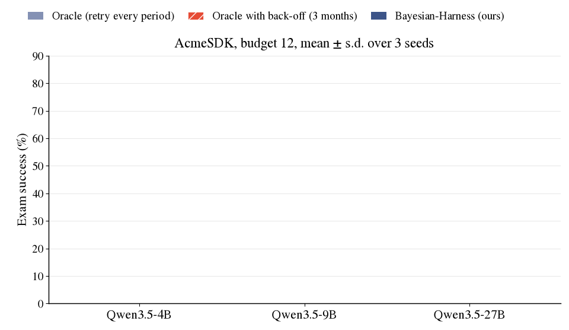

<h1 align="center">Reviewer zpd8 · W2</h1>

<p align="center">
  
  
  
  
  
</p>

> [!NOTE]
> **Branch for Reviewer zpd8, weakness 2.** It adds a back-off switch for the Oracle (no retry for N months after a failed
> repair) and the 27 run logs of the comparison between the retrying Oracle, the Oracle with back-off and Bayesian-Harness,
> 3 models × 3 seeds, AcmeSDK at budget 12. Reviewer TvTY's W2(c) and Q5 point to the same experiment.

## At a glance

| Reviewer's point | What this branch adds | Jump to |
|:---|:---|:---|
| **W2** failed repairs are unclear: why reset the stale status if the note is unchanged, and how this affects the small-budget comparison with the retrying Oracle | the answer, and an Oracle that backs off after a failed repair | [Response](#the-concern) |

---

## The concern

> **W2:** Sections 4.3 and 4.4 leave failed repairs unclear: repairs count only after passing an assertion, yet staleness resets after an attempt. If the old note remains unchanged, why reset its stale status? This also affects the small-budget comparison with the retrying oracle.

**Response.** Thank you for pointing this out; it was not made clear in the paper, and the reviewer is right about the small-budget comparison. Oracle retries every broken note in every period, even notes the model cannot fix. Our reset stops these retries. When we give Oracle the same kind of back-off (no retry for 3 months after a failed repair), it is clearly better than our method, as expected for an oracle.

| (AcmeSDK, budget 12, 3 seeds) | Qwen3.5-4B | Qwen3.5-9B | Qwen3.5-27B |
|:---|:---:|:---:|:---:|
| Oracle, retry every period (paper behaviour) | `32.6 ± 4.2` | `40.4 ± 6.1` | `69.3 ± 3.0` |
| Oracle with back-off, 3 months (new) | `46.1 ± 1.6` | `55.0 ± 4.5` | `73.8 ± 3.2` |
| Bayesian-Harness (ours) | `35.1 ± 4.1` | `46.6 ± 4.2` | `70.9 ± 2.2` |

We will add the Oracle with back-off to the paper and revise the claim. The comparisons with TTL, Bayesian-Agent and two counters are not affected, because these policies also reset a note after any repair attempt.

<p align="center"></p>

## What changed in the code

| File | Change |
|:---|:---|
| [`acmesdk/loop.py`](acmesdk/loop.py) | New flag `--oracle-backoff N` (default `0` = paper behaviour). With `N > 0`, the Oracle does not retry a note for `N` months after a failed repair. |
| [`scripts/run_acmesdk_w2_oracle_backoff.sh`](scripts/run_acmesdk_w2_oracle_backoff.sh) | Runs Oracle, Oracle with back-off and Bayesian-Harness for one model and the given seeds. |

```python
broken = sorted([k for k in ids if not pre[k]
                 and not (a.oracle_backoff > 0 and k in repair_failed_at
                          and m - repair_failed_at[k] <= a.oracle_backoff)],
                key=lambda k: -use_count[k])          # skip notes whose repair failed within the last N months
```

## What this branch adds

```text
rebuttal/zpd8_W2_oracle_backoff/
  logs/acme_q{4b,9b,27b}_s{1,2,3}_mb12_oracle.log            retrying Oracle, one line per month
  logs/acme_q{4b,9b,27b}_s{1,2,3}_mb12_oracle_backoff3.log   Oracle with back-off
  logs/acme_q{4b,9b,27b}_s{1,2,3}_mb12_ours.log              Bayesian-Harness, same job
  summary.csv                                                pooled pass rate ± s.d., written by make_gif.py from the logs
  make_gif.py, style.py                                      rebuild summary.csv and the GIF
```

## Reproduce

```bash
scripts/run_acmesdk_w2_oracle_backoff.sh Qwen/Qwen3.5-4B "1 2 3"     # needs a model server and built worlds
python3 rebuttal/zpd8_W2_oracle_backoff/make_gif.py                  # table and GIF from the logs
```

## Integrity

- The table above is read from `summary.csv`, which `make_gif.py` recomputes from the per-month lines of the 27 logs (pooled pass rate over three seeds, s.d. across seeds).
- The three policies of a seed ran against the same world copy and the same model server, in the same job.

## Environment of the new runs

| | |
|:---|:---|
| Inference | vLLM 0.30.0 (PyTorch 2.13.0+cu130, transformers 5.22.1), one NVIDIA H200, `--max-model-len 32768`, `--gpu-memory-utilization` 0.92 (27B) / 0.90 (4B, 9B) |
| Models | Qwen3.5-4B `851bf6e8`, Qwen3.5-9B `c2022362`, Qwen3.5-27B `fc05daec` (Hugging Face snapshot prefixes) |
| Code | `main` of this repository plus the changes listed above |
| Protocol | identical flags to the paper's main tables; only the policy list differs |
| Anonymization | paths, user and host names in logs and result files were replaced by `$REPO`, `$HOME`, `user`, `node`; nothing else was edited |

Rows marked *paper* in the tables above are the printed values of the paper; rows marked *new* are computed from the files in this branch.

## Other rebuttal branches

Every branch starts from `main`, adds only what the reviewer asked for, and carries its own README.

| Branch | Reviewer | Points | Content |
|:---|:---:|:---:|:---|
| [`reviewer_5Xuf/W1_FactorRuleFilter`](../../tree/reviewer_5Xuf/W1_FactorRuleFilter) | 5Xuf | W1, Q1 | `FactorRuleFilter` (sibling-propagation rule) under both main-table protocols, 36 run logs |
| [`reviewer_5Xuf/W2_exact`](../../tree/reviewer_5Xuf/W2_exact) | 5Xuf | W2, Q2 | exact period-by-period staleness update next to the first-order form used in the paper |
| [`reviewer_zpd8/Q1_failed_repair`](../../tree/reviewer_zpd8/Q1_failed_repair) | zpd8 | Q1 | what happens after a failed repair: reset (paper) vs. keep-as-broken-and-retry, 18 run logs |
| [`reviewer_zpd8/W1_two_counters`](../../tree/reviewer_zpd8/W1_two_counters) | zpd8 | W1, Q2 | two-counter policy under the MaskedMig main-table protocol, 9 run logs |
| [`reviewer_zpd8/W2_oracle_backoff`](../../tree/reviewer_zpd8/W2_oracle_backoff) **(this branch)** | zpd8 | W2 | Oracle with back-off after a failed repair, 27 run logs |
| [`reviewer_TvTY/W1_release_signal`](../../tree/reviewer_TvTY/W1_release_signal) | TvTY | W1, Q1, Q2, Q3 | release-aware baseline (version bump / changelog), sensitivity sweep on the reviewer's grid, calibration data |
| [`reviewer_TvTY/W2_paired_tests`](../../tree/reviewer_TvTY/W2_paired_tests) | TvTY | W2, Q4, Q5, Q6 | paired McNemar tests for every main-table cell, low-quality-notes world, pointer to the Oracle ceiling |

The full code release and its documentation are on the [`main`](../../tree/main) branch. The data (19 generated worlds, 157 masked migrations) is in the companion [bayesian_harness_datasets](https://github.com/anonymouspaper987/bayesian_harness_datasets) repository.
