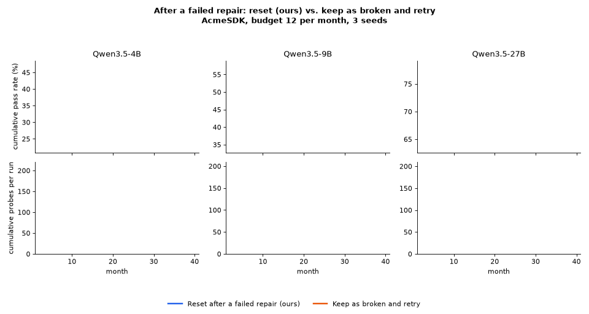

> [!NOTE]
> **Branch for Reviewer zpd8, Q1.** This branch adds one switch for failed repairs and the run logs of the comparison.

## Reviewer zpd8, Q1: what happens after a failed repair?

> **Q1:** After a failed repair, what happens to the note, its staleness belief, and its quality counts? Is retry suppression separate from the belief update?

**Response.** Thank you for pointing this out. You are right that the staleness is reset after a failed repair. Strictly speaking, we treat this as a decision rule rather than a belief update, and we do it on purpose. The note itself is unchanged and its quality counts are untouched. A note the model could not fix is likely to fail again, so retrying it every period wastes the budget. If the note is still in use, its failed exams soon raise its staleness again.

We also ran a variant that keeps the note marked as broken and retries it every period.

<p align="center"></p>

| (AcmeSDK, budget 12, 3 seeds) | Qwen3.5-4B | Qwen3.5-9B | Qwen3.5-27B |
| :--- | :---: | :---: | :---: |
| Reset after a failed repair (ours) | **35.1 ± 4.1** | **46.6 ± 4.2** | **70.9 ± 2.2** |
| Keep as broken and retry | 25.9 ± 3.3 | 37.8 ± 3.1 | 68.5 ± 1.8 |
| Probes per run, reset / keep | 200 / 48 | 190 / 51 | 190 / 109 |

Resetting is better at every model size. When a note stays in the broken queue, it is repaired again every month, and those repairs keep failing. This uses up the budget, so far fewer notes get probed and new breaks are found late.

### What changed in the code

| File | Change |
| :--- | :--- |
| [`acmesdk/loop.py`](acmesdk/loop.py) | New flag `--keep-stale-on-failed-repair` (default `0` = paper behaviour). With `1`, a failed repair is recorded as an invalid observation and the note goes back to the known-broken queue. |
| [`scripts/run_acmesdk_q1_failed_repair.sh`](scripts/run_acmesdk_q1_failed_repair.sh) | Runs both variants for one model. |
| [`rebuttal/zpd8_Q1_failed_repair/logs/`](rebuttal/zpd8_Q1_failed_repair/logs) | 18 run logs (3 models x 3 seeds x 2 variants). |
| [`rebuttal/zpd8_Q1_failed_repair/make_gif.py`](rebuttal/zpd8_Q1_failed_repair/make_gif.py) | Rebuilds the table ([`summary.csv`](rebuttal/zpd8_Q1_failed_repair/summary.csv)) and the GIF from the logs. |

```bash
# reproduce one model (needs a model server, see scripts/serve_vllm.sh)
scripts/run_acmesdk_q1_failed_repair.sh Qwen/Qwen3.5-4B "1 2 3"
# rebuild the table and the GIF from the logs
python3 rebuttal/zpd8_Q1_failed_repair/make_gif.py
```

The full code release and its documentation are on the [`main`](../../tree/main) branch.
