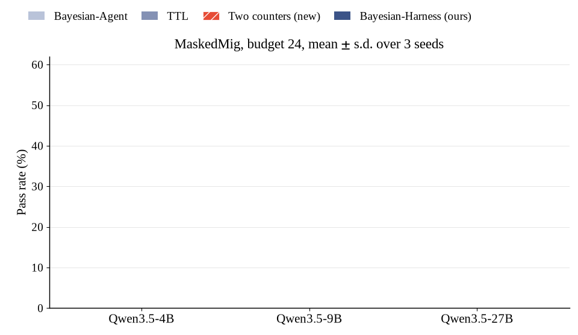

> [!NOTE]
> **Branch for Reviewer zpd8, W1.** This branch adds the run logs of the two-counter policy under the MaskedMig main-table protocol. The code is the same as `main`.

## Reviewer zpd8, W1: two-counter policy in the main setting

> **W1:** Section 4.3 reduces Bayesian-Agent [BA26] to a feature-free Beta posterior, so the comparison does not evaluate its full method. I would appreciate a main-setting comparison with the two-counter policy already used in Table 3. Please also distinguish persistent API changes from the probabilistic execution failures studied in ResiliBench [RB26]; this would clarify which failures the validity–quality model is intended to separate.


**Response:** Thank you for the helpful suggestions.

On Bayesian-Agent, [BA26] conditions its posterior on `[features used in BA26]`. Our notes carry no such features, so we keep its core, one Beta posterior per note. The two-counter policy can be seen as a stronger version of it that adds a time clock.

Following your suggestion, we ran the two-counter policy under the main-table protocol of MaskedMig.

> | (MaskedMig, budget 24, 3 seeds) | Qwen3.5-4B | Qwen3.5-9B | Qwen3.5-27B |
> | :--- | :---: | :---: | :---: |
> | Bayesian-Agent | 14.0 ± 4.8 | 18.5 ± 2.3 | 36.3 ± 7.8 |
> | TTL | 17.8 ± 3.9 | 22.9 ± 2.3 | 40.1 ± 7.6 |
> | Two counters | `16.3 ± 1.6` | `20.4 ± 2.3` | `38.0 ± 3.3` |
> | **Bayesian-Harness (ours)** | **25.5 ± 1.7** | **29.9 ± 2.2** | **48.4 ± 2.8** |

Two counters performs close to TTL and stays 9 to 10 points below our method at every model size.

ResiliBench looks at random failures; we instead look at lasting changes. Our method splits the cause of a failure into two factors, Validity and Quality. Validity asks whether the API has changed. Quality asks whether the note itself is good. Random failures are not part of our setting.

<p align="center"></p>

### Files

| Path | Content |
| :--- | :--- |
| [`rebuttal/zpd8_W1_two_counters/logs/`](rebuttal/zpd8_W1_two_counters/logs) | MaskedMig runs of the two-counter policy (3 models x 3 seeds). |
| [`rebuttal/zpd8_W1_two_counters/make_gif.py`](rebuttal/zpd8_W1_two_counters/make_gif.py) | Draws the GIF above. |
| [`bayesian_harness/filters.py`](bayesian_harness/filters.py) | `TwoCountersFilter` (registry name `two_counters`): TTL clock + running success rate. |

```bash
# reproduce one cell (needs a model server, see scripts/serve_vllm.sh)
LANES=two_counters scripts/run_maskedmig.sh Qwen/Qwen3.5-27B 24 1
```

The full code release and its documentation are on the [`main`](../../tree/main) branch.
