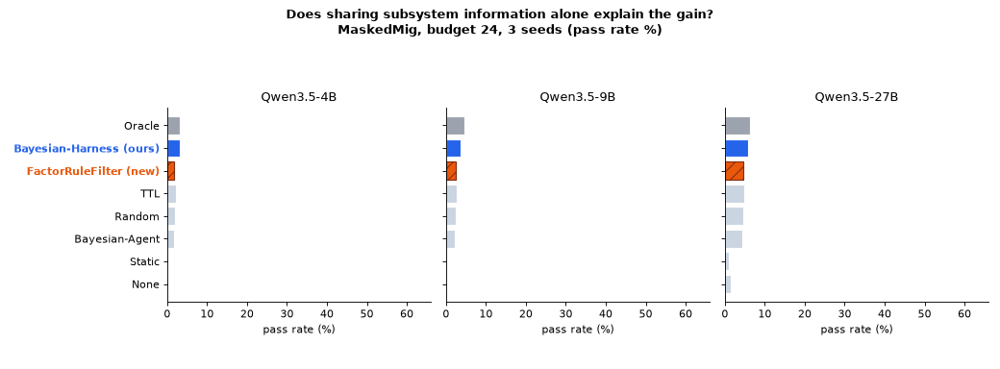

> [!NOTE]
> **Branch for Reviewer 5Xuf, W1 / Q1.** This branch adds the run logs of `FactorRuleFilter` under the main-table protocol. The code is the same as `main`.

## Reviewer 5Xuf, W1: comparison with `FactorRuleFilter`

> **W1:** **Comparison with baselines.** The main experiments primarily compare against TTL and Bayesian-Agent, neither of which exploits shared subsystem information in the same way. The repository includes `FactorRuleFilter`, a simpler non-Bayesian method that propagates suspected invalidity across related memories, but it is absent from the main results.


**Response:** We sincerely thank you for taking the time to our code repository. `FactorRuleFilter` is part of our design, not a full method framework, which is the main reason we didn't compare it in our paper, but we left it in a branch of our repository. Following your insightful suggestion, we have now fully evaluated FactorRuleFilter across all three Qwen3.5 model sizes. The results are in the following table:


> | (MaskedMig, budget 24, 3 seeds) | Qwen3.5-4B | Qwen3.5-9B | Qwen3.5-27B |
> | :--- | :---: | :---: | :---: |
> | Oracle | 27.4 ± 1.9 | 38.9 ± 2.5 | 52.2 ± 1.3 |
> | None | 0.6 ± 0.6 | 0.6 ± 1.1 | 12.1 ± 0.6 |
> | Static | 0.6 ± 0.0 | 1.3 ± 2.2 | 8.9 ± 8.3 |
> | Random | 16.6 ± 5.1 | 21.0 ± 8.0 | 37.6 ± 1.7 |
> | Bayesian-Agent | 14.0 ± 4.8 | 18.5 ± 2.3 | 36.3 ± 7.8 |
> | TTL | 17.8 ± 3.9 | 22.9 ± 2.3 | 40.1 ± 7.6 |
> | `FactorRuleFilter (new)` | `14.9 ± 2.0` | `20.0 ± 2.0` | `39.3 ± 2.9` |
> | **Bayesian-Harness (ours)** | **25.5 ± 1.7** | **29.9 ± 2.2** | **48.4 ± 2.8** |

From the table, we can see the benefits come mainly from the validity and quality, instead of just sharing the subsystem information.

> **Q1:** How does Bayesian-Harness compare with `FactorRuleFilter` and simpler subsystem-aware heuristics under the same budgets?


**Response:**  `FactorRuleFilter` is an intermediate step in the design of `Bayesian-Harness` rather than a complete method, which is why we left it in the code with some notes. To address your concern, we also conducted experiments evaluating `FactorRuleFilter`, and the results are reported in response to your `W1`.

<p align="center"></p>

### Files

| Path | Content |
| :--- | :--- |
| [`rebuttal/W1_FactorRuleFilter/logs/`](rebuttal/W1_FactorRuleFilter/logs) | `mig_*`: MaskedMig runs (3 models x 3 seeds). `acme_*`: AcmeSDK runs at budgets 12 / 24 / 48. `vllm_*`: model server logs. |
| [`rebuttal/W1_FactorRuleFilter/make_gif.py`](rebuttal/W1_FactorRuleFilter/make_gif.py) | Draws the GIF above. |
| [`bayesian_harness/filters.py`](bayesian_harness/filters.py) | `FactorRuleFilter` (registry name `factor_rule`). |

```bash
# reproduce one cell (needs a model server, see scripts/serve_vllm.sh)
LANES=factor_rule scripts/run_maskedmig.sh Qwen/Qwen3.5-27B 24 1
```

The full code release and its documentation are on the [`main`](../../tree/main) branch.
