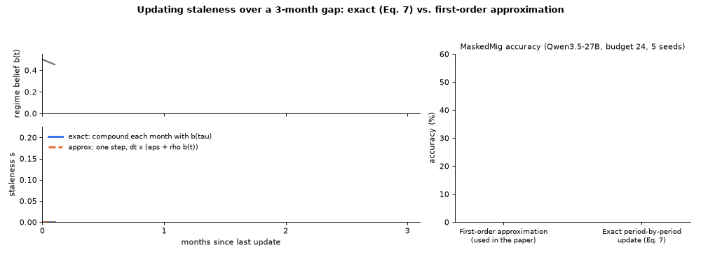

> [!NOTE]
> **Branch for Reviewer 5Xuf, W2 / Q2.** This branch adds the exact period-by-period update of Eq. 8 next to the first-order approximation used for the paper's numbers. Code only, no run logs.

## Reviewer 5Xuf, W2: approximation in `_touch_entry`

> **W2:** Equation 7 and Appendix A.1 describe updating staleness period by period as the regime belief evolves. However, the released `_touch_entry` implementation appears to multiply the one-period hazard, evaluated using the final regime belief, by the number of elapsed periods.
>
> **Q2:** Is the multi-period update in `_touch_entry` an intentional approximation? How does it affect the results compared with the update described in the paper?

**Response.** Thank you for pointing this out. Your observation is correct. Our implementation uses a first-order approximation, and it only affects the MaskedMig benchmark.

1. **We ran the exact period-by-period update.** We re-ran our method on MaskedMig with the update exactly as written in the paper, under the main-table protocol.

   | (MaskedMig, Qwen3.5-27B, budget 24, 5 seeds) | Accuracy (%) |
   | :--- | :---: |
   | First-order approximation (used in the paper) | 48.5 ± 2.2 |
   | Exact period-by-period update | 46.9 ± 4.0 |

   The two differ by only 1.6 points, well within the seed-to-seed spread (about 4 points), and make nearly the same maintenance decisions. Our conclusions are unchanged.

2. **Where the approximation matters.** On AcmeSDK the filter is updated every month, so each update spans exactly one period and the two versions are identical. Only MaskedMig, where one update spans a quarter (three months), is affected.

3. **We will revise the paper.** We will revise Eq. 8 and Appendix A.1 to describe the approximation actually used, and add this comparison to the appendix.

4. **We release both versions** in this branch.

<p align="center"></p>

The GIF shows one note over a 3-month gap. The exact update compounds once per month with the belief at that month. The approximation takes one step with the belief at the end of the gap, so a burst early in the gap counts for less. Individual scores can move, but the ranking of notes, and so the maintenance decisions, stay nearly the same.

### What changed in the code

| File | Change |
| :--- | :--- |
| [`bayesian_harness/filters.py`](bayesian_harness/filters.py) | New `FilterConfig.compose_per_period` (default `0` = approximation, paper numbers). With `1`, `_touch_entry` calls `_compose_entry`, which applies Eq. 8 once per period with the regime belief `b(tau)` from Eq. 7. |
| [`scripts/run_maskedmig_w2_exact.sh`](scripts/run_maskedmig_w2_exact.sh) | Runs both versions on MaskedMig (budget 24, `--t-scale 3`). |
| [`rebuttal/W2_exact/make_gif.py`](rebuttal/W2_exact/make_gif.py) | Draws the GIF above. |

```bash
# reproduce (needs a model server, see scripts/serve_vllm.sh)
scripts/run_maskedmig_w2_exact.sh Qwen/Qwen3.5-27B "1 2 3 4 5"
```

The full code release and its documentation are on the [`main`](../../tree/main) branch.
