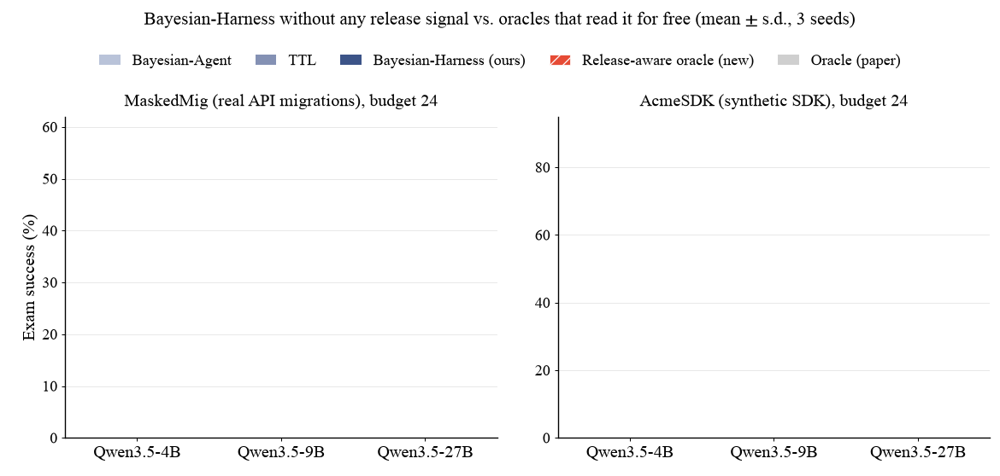
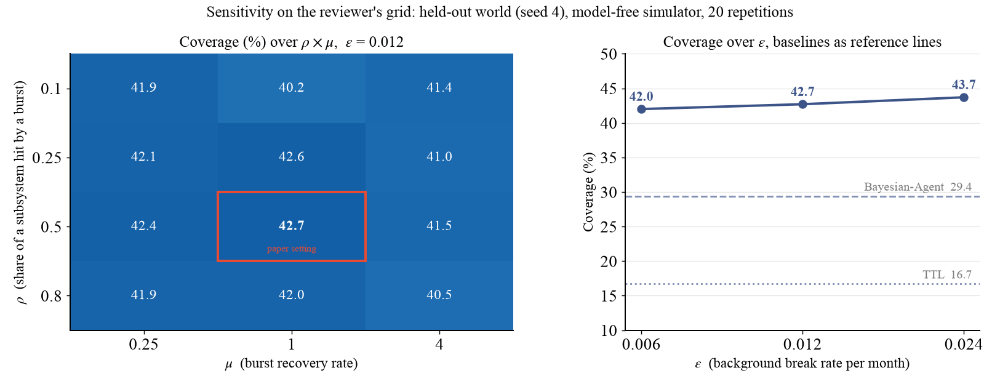

<h1 align="center">Reviewer TvTY · W1, Q1, Q2, Q3</h1>

<p align="center">
  
  
  
  
  
</p>

> [!NOTE]
> **Material for Reviewer TvTY, weakness 1 and questions 1 to 3.** It adds the release-aware baseline the reviewer asked for
> (`release_aware`: probe what the version bump or the changelog points at), run under both main-table protocols with
> every result row; the sensitivity sweep on the reviewer's own grid of ρ, µ, ε; and the real-repository
> calibration figures behind the generator constants. The two stronger non-Bayesian baselines of W1(c) live in their
> own branches and are linked below.

## At a glance

| Reviewer's point | What this folder adds | Jump to |
|:---|:---|:---|
| **W1(b), Q1** withheld changelog and version signals | a policy that reads the release signal before choosing what to probe, on MaskedMig (version bump) and AcmeSDK (changelog), 3 models × 3 seeds each | [Release-aware baseline](#1-release-aware-baseline-w1b-q1) |
| **W1(a), Q2** generator–model alignment, sensitivity | the reviewer's grid ρ ∈ {0.1, 0.25, 0.5, 0.8} × µ ∈ {0.25, 1, 4} × ε ∈ {0.006, 0.012, 0.024} on a held-out world, plus the 81-setting sweep of the appendix and the commit-history calibration table | [Sensitivity and calibration](#2-sensitivity-and-calibration-w1a-q2) |
| **W1(c), Q3** baseline strength | two-counter policy and sibling-propagation rule under the main protocol | [Stronger baselines](#3-stronger-baselines-w1c-q3) |

---

## 1. Release-aware baseline (W1(b), Q1)

> **W1(b):** *Withheld changelog and version signals.* By design, a policy may not use the changelog to choose which item to maintain; it can read the changelog only after selecting an item. In practice, release notes and deprecation warnings are exactly how practitioners know what went stale, and package versions are always observable. On MASKEDMIG this is especially consequential. Every library's items break in the quarter of that library's release and never recover. A trivial "probe items of any library whose installed version changed" baseline would therefore likely approach the oracle. [...] The paper needs either a compelling deployment scenario where this information is unavailable, or a version/changelog-aware baseline.
>
> **Q1:** Please describe a concrete deployment where an agent cannot observe which package or subsystem released, or read release notes, before choosing what to probe. How does Bayesian-Harness compare with (i) a version-bump baseline on MASKEDMIG and (ii) a changelog-aware baseline on ACMESDK?

**Response.** This paper is more focused on the scenario where the changelog is inaccessible. Internal APIs, services and team conventions have no changelog and no version number, and in this setting we learn the Quality and Validity latent variables to represent staleness. A concrete case is an internal platform team. Its services, SDK wrappers and conventions change through merged pull requests, with no release notes and no version number an agent can read. The agent's notes are the only record, and a probe is the only way to learn that one went stale. Public libraries also change behaviour without a note.

We also ran the two policies the reviewer describes, as oracles: they read the release signal for free, which our setting does not allow. On MaskedMig the version-bump oracle probes every note of a library whose version changed, and on AcmeSDK the changelog oracle probes every note named in the month's release notes.

| (budget 24, 3 seeds) | Qwen3.5-4B | Qwen3.5-9B | Qwen3.5-27B |
|:---|:---:|:---:|:---:|
| **MaskedMig** · **Bayesian-Harness (ours, paper)** | **25.5 ± 1.7** | **29.9 ± 2.2** | **48.4 ± 2.8** |
| **MaskedMig** · Oracle version-bump, reads every version change (new) | `26.1 ± 1.7` | `29.7 ± 2.6` | `48.2 ± 1.6` |
| **MaskedMig** · Oracle, reads every release note (paper) | 27.4 ± 1.9 | 38.9 ± 2.5 | 52.2 ± 1.3 |
| **MaskedMig** · TTL (paper) | 17.8 ± 3.9 | 22.9 ± 2.3 | 40.1 ± 7.6 |
| **AcmeSDK** · **Bayesian-Harness (ours, paper)** | **40.7 ± 3.8** | **52.8 ± 7.7** | **74.6 ± 1.4** |
| **AcmeSDK** · Oracle changelog-aware, reads every release note (new) | `54.2 ± 4.5` | `64.7 ± 3.0` | `81.3 ± 1.7` |
| **AcmeSDK** · Oracle, reads every release note after selection (paper) | 40.2 ± 1.7 | 54.5 ± 7.5 | 78.1 ± 3.2 |
| **AcmeSDK** · TTL (paper) | 36.2 ± 2.7 | 51.2 ± 4.0 | 62.9 ± 4.4 |

Without any release signal, **Bayesian-Harness** is close to the version-bump oracle on MaskedMig, which reads the version signal for free. The oracle rows are run on our rebuttal stack and the ours rows are the values printed in the paper, so the gaps are indicative. On AcmeSDK the changelog oracle sits above, as expected for an oracle that reads every release note. Our method is for the case where the notes are absent. When a release signal exists it can be added as evidence on the library's shared factor, so the two are complementary. We will add this comparison and this discussion to the paper.

<p align="center"></p>

<details>
<summary><strong>How the baseline works</strong></summary>

`ReleaseAwareFilter` extends `TTLFilter`. At the start of every maintenance period the loop hands it the notes the release signal points at:

- **MaskedMig (version bump).** Every note of a library whose installed version changed since the previous maintenance quarter. All 157 notes are flagged exactly once over the nine quarters, when their library turns over (`release_flagged.csv`).
- **AcmeSDK (changelog).** Every note whose API is named in that month's release notes, matched on the API the note snippet currently calls. About 9 notes per month out of roughly 410 (`release_flagged.csv`; the counter was added to the maintenance log after the 27B runs, so those rows read 0 although the flags were applied).

A flagged note gets stale score 1.0 and is probed first. Leftover budget follows the plain TTL order. A probe or a repair clears the flag. Everything else, budget, probe cost, repair cost, exam, is the main-table protocol.

</details>

---

## 2. Sensitivity and calibration (W1(a), Q2)

> **W1(a):** *Generator–model alignment on ACMESDK.* The synthetic world is produced by a generator whose structure closely mirrors the inference model [...]. The constants are said to be estimated from XGBoost/OpenCV/SciPy/vLLM, but the near-exact match with the generator is striking. [...] A sensitivity sweep over ε, ρ, µ, or a world with genuinely unstructured drift, is missing.
>
> **Q2:** Please report the actual measured values of ε, ρ, µ [...] and explain why they coincide so closely with the generator settings. Please also provide a sensitivity sweep, e.g., ρ ∈ {0.1, 0.25, 0.5, 0.8}, µ ∈ {0.25, 1, 4}.

**Response.** We agree with this comment. This is why we set AcmeSDK as a complementary benchmark, and its results are mainly in the appendix. Instead, we extracted real library changes to form MaskedMig, and made experiments there to show unbiased performance in the main paper.

The constants and the generator come from different libraries. We estimated ε, ρ and µ from XGBoost, OpenCV, SciPy and vLLM, and calibrated the generator on scikit-learn, django and xarray. They agree because both reflect how real libraries change. We used the rounded values in the paper and did not keep finer intermediate values, so we cannot report more digits; the sweep below shows that the exact values do not matter for the result.

**Calibration data** (`calibration_repo_facts.csv`, real commit histories, 60 monthly snapshots from 2021 to 2025):

| | scikit-learn | django | xarray |
|:---|:---:|:---:|:---:|
| Monthly break rate of function signatures | 0.94% | 0.19% | 2.17% |
| Share of a month's breaks in one subpackage | 55% | 67% | 82% |
| Burst strength (worst month / median month) | 17.7× | 8.3× | 28.4× |

The constant ε = 0.012 sits inside the real range of monthly break rates. The one-subpackage share is why drift is grouped, and the burst strength is why heavy months exist.

**Sensitivity on the reviewer's grid** (`sweep_grid.py`, output in `sweep_grid_output.md`). Held-out world seed 4, the model-free simulator of the appendix sweep, 20 repetitions. Coverage is the share of exams whose own note is current. The paper setting is ρ = 0.5, µ = 1, ε = 0.012.

| rho \ mu | 0.25 | 1 | 4 |
|---|---|---|---|
| 0.1 | 41.9 | 40.2 | 41.4 |
| 0.25 | 42.1 | 42.6 | 41.0 |
| 0.5 | 42.4 | 42.7 | 41.5 |
| 0.8 | 41.9 | 42.0 | 40.5 |

| eps | 0.006 | 0.012 | 0.024 |
|---|---|---|---|
| coverage | 42.0 | 42.7 | 43.7 |

Across all 36 settings coverage stays between `37.6` and `43.8` (median 42.0). TTL reaches 16.7 and Bayesian-Agent 29.4 under the same protocol. The constants move the result by a few points, and no setting comes near the baselines.

<p align="center"></p>

**The 81-setting sweep of the appendix** (`sweep_81_settings.txt`, same simulator and world, ρ × µ × ε × κ):

| (AcmeSDK, held-out world, 81 settings) | Coverage (%) |
|:---|:---:|
| Default (ρ = 0.5, µ = 1, ε = 0.012, κ = 5) | 45.2 |
| Best (ρ = 0.7, µ = 0.5, ε = 0.012, κ = 10) | 46.0 |
| Median of 81 | 43.0 |
| Worst of 81 | `40.4` |
| Bayesian-Agent | `31.3` |

Every setting stays above Bayesian-Agent. The stress tests of the paper also include a world with unstructured drift: in the "no heavy months" world all drift is background drift at 2.4% per month, with no bursts and no groups, and our method still leads with `74.8` against 66.0 for TTL and 66.6 for Bayesian-Agent.

---

## 3. Stronger baselines (W1(c), Q3)

> **W1(c):** *Baseline strength.* Bayesian-Agent [...] is reduced to the mean of a per-item Beta posterior [...]. There is no baseline that propagates a failure to sibling items in the same subsystem [...]. The "two counters" baseline of §4.6 appears only in the separability study.
>
> **Q3:** Is the feature-free reduction faithful to Wu et al. (2026)? Did you consider giving it simple features (subsystem ID, time since verification)? Please also add a non-Bayesian "propagate failure to subsystem siblings" baseline to the main tables.

**Response.** The reduction is not a handicap. Neither our method nor Bayesian-Agent receives feature information in our benchmarks. Both see the same exam outcomes and the same probe budget, which is a fair comparison. Bayesian-Agent's maintenance triggers (their Eq. 15) use only the unconditioned success posterior and the failure count, so the feature-free form is its own maintenance policy. Giving it a subsystem ID and time since verification is the two-counter policy, which we report under the main protocol next to the sibling-propagation rule the reviewer asks for.

| (MaskedMig, budget 24, 3 seeds) | Qwen3.5-4B | Qwen3.5-9B | Qwen3.5-27B | Branch |
|:---|:---:|:---:|:---:|:---|
| Bayesian-Agent (paper) | 14.0 ± 4.8 | 18.5 ± 2.3 | 36.3 ± 7.8 | `main` |
| TTL, MemoryBank decay (paper) | 17.8 ± 3.9 | 22.9 ± 2.3 | 40.1 ± 7.6 | `main` |
| Two counters, Bayesian-Agent + time clock + group (new) | 16.3 ± 1.6 | 20.4 ± 2.3 | 38.0 ± 3.3 | [`reviewer_zpd8/W1_two_counters`](https://github.com/anonymouspaper987/Bayesian_Harness/tree/reviewer_zpd8/rebuttal/zpd8_W1_two_counters) |
| Sibling propagation rule, `FactorRuleFilter` (new) | 14.9 ± 2.0 | 20.0 ± 2.0 | 39.3 ± 2.9 | [`reviewer_5Xuf/W1_FactorRuleFilter`](https://github.com/anonymouspaper987/Bayesian_Harness/tree/reviewer_5Xuf/rebuttal/W1_FactorRuleFilter) |
| **Bayesian-Harness (ours, paper)** | **25.5 ± 1.7** | **29.9 ± 2.2** | **48.4 ± 2.8** | `main` |

Both perform like TTL and stay below our method at every model size. The new rows are run on our rebuttal stack and the ours row is the value printed in Table 1, so the gaps are indicative. We will add both rows to the main tables.

---

## What this folder adds

```text
bayesian_harness/filters.py                         ReleaseAwareFilter + registry name release_aware      (+41 lines)
acmesdk/loop.py                                     changelog hook: flag notes named in this month's notes (+28 lines)
maskedmig/masked_loop.py                            version hook: flag notes of libraries that turned over (+9 lines)
scripts/run_release_aware.sh                        both corpora, one model, three seeds
rebuttal/TvTY_W1_release_signal/
  results/acmesdk/seed{1,2,3}/tq1_qwen*_mb24_release_aware.jsonl          one row per exam
  results/acmesdk/seed{1,2,3}/tq1_qwen*_mb24_release_aware.maint.jsonl    one row per month (probes, repairs, release_flagged)
  results/maskedmig/tq1_q*_s*_mb24_release_aware.jsonl                    one row per migration
  results/maskedmig/tq1_q*_s*_mb24_release_aware.maint.jsonl              one row per quarter
  summary.csv                                       pooled pass rate ± s.d. of the new baseline
  release_flagged.csv                               how many notes the release signal flagged per period
  sweep_grid.py / sweep_grid_output.md              reviewer's grid, deterministic, 20 repetitions
  sweep_81_settings.txt                             the appendix sweep (ρ × µ × ε × κ), unedited output
  calibration_repo_facts.csv                        the three calibration libraries
  make_figures.py, style.py                         rebuild summary.csv, release_flagged.csv, the GIF and the PNG
```

<details>
<summary><strong>The code change, in full</strong></summary>

```python
class ReleaseAwareFilter(TTLFilter):
    name = "release_aware"

    def observe_release(self, keys, t):          # called by the loop at the start of a period
        self.flagged.update(k for k in keys if k in self.ab)

    def stale_score(self, k, t):                 # flagged notes are probed first
        return 1.0 if k in self.flagged else super().stale_score(k, t)

    def observe_probe(self, k, is_valid, t):     # a probe or a repair clears the flag
        self.flagged.discard(k); super().observe_probe(k, is_valid, t)
```

```python
# acmesdk/loop.py, start of month m
if flt is not None and hasattr(flt, "observe_release"):
    _named = changelog_names(W, m)                       # every `subsystem.name` in changelog/M{m:02d}.md
    _hit = [k for k in ids if k not in retired and note_api(notes[k]["snippet"]) in _named]
    flt.observe_release(_hit, m)

# maskedmig/masked_loop.py, start of quarter q
if flt is not None and hasattr(flt, "observe_release"):
    q_prev = exam_qs[qi - 2] if qi > 1 else ""
    _hit = [k for k in ids if q_prev < notes[k]["task_ref"]["quarter"] <= q]   # library turned over since last quarter
    flt.observe_release(_hit, tf)
```

</details>

## Reproduce

```bash
# release-aware baseline, both corpora, one model (needs a model server, built worlds and the migration environments)
scripts/serve_vllm.sh Qwen/Qwen3.5-27B 8000
scripts/run_release_aware.sh Qwen/Qwen3.5-27B "1 2 3"          # ~1 h on one H200 for 27B

# sensitivity on the reviewer's grid (CPU only, ~2 min, needs world seed 4: scripts/build_world.sh 4)
python3 rebuttal/TvTY_W1_release_signal/sweep_grid.py 20

# tables and figures from the files in this folder
python3 rebuttal/TvTY_W1_release_signal/make_figures.py
```

## Reading the result files

`*.jsonl` has one JSON object per exam (`task_id`, period, `solved`, the note that was injected, the error text if any).
`*.maint.jsonl` has one object per period with the maintenance counters: `probes`, `probe_valid`, `repairs`, `repair_ok`,
`budget_spent`, and `release_flagged`, the number of notes the release signal pointed at in that period.

## Integrity

- AcmeSDK result files have one row per scheduled exam: 346 / 343 / 330 rows for seeds 1 / 2 / 3, 1019 per model. Every MaskedMig file has 157 rows. 4470 result rows in total.
- `summary.csv` is recomputed from these rows by `make_figures.py`; the table above is read from it.
- All 18 runs completed in one job (27B, then 4B, then 9B), every run with exit code 0.

## Environment of the new runs

| | |
|:---|:---|
| Inference | vLLM 0.30.0 (PyTorch 2.13.0+cu130, transformers 5.22.1), one NVIDIA H200, `--max-model-len 32768`, `--gpu-memory-utilization` 0.92 (27B) / 0.90 (4B, 9B) |
| Models | Qwen3.5-4B `851bf6e8`, Qwen3.5-9B `c2022362`, Qwen3.5-27B `fc05daec` (Hugging Face snapshot prefixes) |
| Code | `main` of this repository plus the changes listed above |
| Protocol | identical flags to the paper's main tables; only the policy list differs |
| Anonymization | paths, user and host names in logs and result files were replaced by `$REPO`, `$HOME`, `user`, `node`; nothing else was edited |

Rows marked *paper* in the tables above are the printed values of the paper; rows marked *new* are computed from the files in this folder.

## Other rebuttal material

Every branch starts from `main`, adds only what the reviewer asked for, and carries its own README.

| Branch | Reviewer | Points | Content |
|:---|:---:|:---:|:---|
| [`reviewer_5Xuf/W1_FactorRuleFilter`](https://github.com/anonymouspaper987/Bayesian_Harness/tree/reviewer_5Xuf/rebuttal/W1_FactorRuleFilter) | 5Xuf | W1, Q1 | `FactorRuleFilter` (sibling-propagation rule) under both main-table protocols, 36 run logs |
| [`reviewer_5Xuf/W2_exact`](https://github.com/anonymouspaper987/Bayesian_Harness/tree/reviewer_5Xuf/rebuttal/W2_exact) | 5Xuf | W2, Q2 | exact period-by-period staleness update next to the first-order form used in the paper |
| [`reviewer_zpd8/Q1_failed_repair`](https://github.com/anonymouspaper987/Bayesian_Harness/tree/reviewer_zpd8/rebuttal/zpd8_Q1_failed_repair) | zpd8 | Q1 | what happens after a failed repair: reset (paper) vs. keep-as-broken-and-retry, 18 run logs |
| [`reviewer_zpd8/W1_two_counters`](https://github.com/anonymouspaper987/Bayesian_Harness/tree/reviewer_zpd8/rebuttal/zpd8_W1_two_counters) | zpd8 | W1, Q2 | two-counter policy under the MaskedMig main-table protocol, 9 run logs |
| [`reviewer_zpd8/W2_oracle_backoff`](https://github.com/anonymouspaper987/Bayesian_Harness/tree/reviewer_zpd8/rebuttal/zpd8_W2_oracle_backoff) | zpd8 | W2 | Oracle with back-off after a failed repair, 27 run logs |
| [`reviewer_TvTY/W1_release_signal`](https://github.com/anonymouspaper987/Bayesian_Harness/tree/reviewer_TvTY/rebuttal/TvTY_W1_release_signal) **(this folder)** | TvTY | W1, Q1, Q2, Q3 | release-aware baseline (version bump / changelog), sensitivity sweep on the reviewer's grid, calibration data |
| [`reviewer_TvTY/W2_paired_tests`](https://github.com/anonymouspaper987/Bayesian_Harness/tree/reviewer_TvTY/rebuttal/TvTY_W2_paired_tests) | TvTY | W2, Q4, Q5, Q6 | paired McNemar tests for every main-table cell, low-quality-notes world, pointer to the Oracle ceiling |

The full code release and its documentation are on the [`main`](https://github.com/anonymouspaper987/Bayesian_Harness/tree/main) branch. The data (19 generated worlds, 157 masked migrations) is in the companion [bayesian_harness_datasets](https://github.com/anonymouspaper987/bayesian_harness_datasets) repository.
