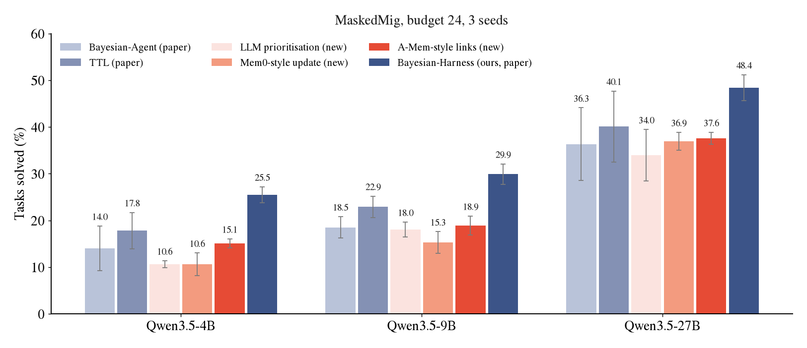

<h1 align="center">Reviewer TvTY · W1(c)</h1>

<p align="center">
  
  
  
  
  
</p>

> [!NOTE]
> **Material for Reviewer TvTY, weakness 1(c).** It adds the two kinds of baseline the reviewer found missing: an
> LLM-driven prioritisation baseline, and baselines that follow the memory systems of the related work (Mem0 and
> A-Mem). All three run under the MaskedMig main-table protocol at three model sizes with three seeds, and every
> result row and run log is in this folder. The two-counter policy and the sibling-propagation rule of W1(c) are in
> [`TvTY_W1_release_signal`](../TvTY_W1_release_signal#3-stronger-baselines-w1c-q3).

## At a glance

| Reviewer's point | What this folder adds | Jump to |
|:---|:---|:---|
| **W1(c)** no LLM-driven prioritisation baseline | `llm_rank`: the model ranks which notes to check, once per quarter | [Results](#results) |
| **W1(c)** no memory system from related work | `mem0` (Mem0-style update) and `amem` (A-Mem-style links); TTL is the MemoryBank decay rule | [How the baselines work](#how-the-baselines-work) |

---

## Results

> **W1(c):** *Baseline strength.* [...] There are also gaps on the non-Bayesian side: [...] There is no LLM-driven prioritisation baseline. None of the memory systems discussed in related work (MemoryBank decay, Mem0, A-Mem) is evaluated.

**Response.** We added three more baselines. The first lets the LLM rank which notes to check in every period. The second follows the update rule of Mem0, where the LLM marks a note as outdated after each task. The third follows A-Mem, where notes are linked by content and a broken note flags its linked notes. LLM calls are free for all three.

| (MaskedMig, budget 24, 3 seeds) | Qwen3.5-4B | Qwen3.5-9B | Qwen3.5-27B |
|:---|:---:|:---:|:---:|
| Bayesian-Agent (paper) | 14.0 ± 4.8 | 18.5 ± 2.3 | 36.3 ± 7.8 |
| TTL, MemoryBank decay (paper) | 17.8 ± 3.9 | 22.9 ± 2.3 | 40.1 ± 7.6 |
| LLM prioritisation, `llm_rank` (new) | `10.6 ± 0.7` | `18.0 ± 1.6` | `34.0 ± 5.5` |
| Mem0-style update, `mem0` (new) | `10.6 ± 2.4` | `15.3 ± 2.3` | `36.9 ± 1.9` |
| A-Mem-style links, `amem` (new) | `15.1 ± 1.0` | `18.9 ± 2.0` | `37.6 ± 1.3` |
| **Bayesian-Harness (ours, paper)** | **25.5 ± 1.7** | **29.9 ± 2.2** | **48.4 ± 2.8** |

All three stay below our method at every model size. We will add them to the paper.

<p align="center"></p>

Rows marked *paper* are the printed values of the paper. Rows marked *new* are computed from the files in this folder (`summary.csv`, which also lists every seed).

## How the baselines work

These systems do not have a step that picks notes to verify under a budget. What we port is the mechanism each one uses to decide which memory to touch. They are adaptations written for this protocol, not runs of the original code bases.

- **`llm_rank`, LLM-driven prioritisation.** At the start of every quarter the model sees one row per note: library, API, months since it was last confirmed working, how often it was read, task passes and failures since the last check, and the results of last quarter's checks. It returns the 48 notes it finds most suspicious, in order (twice the budget). These are probed first, in the model's order.
- **`mem0`, Mem0-style update.** Mem0 compares new information with the memories it retrieved and decides `ADD`, `UPDATE`, `DELETE` or `NONE` for each. Here every exam is the new information (outcome, error text, submitted code), and the memories are the notes that were in context. A note marked `UPDATE` or `DELETE` is flagged and probed first.
- **`amem`, A-Mem-style links.** A-Mem links each note to its nearest notes and lets a change in one note evolve its linked notes. Here each note is linked to its 5 nearest notes by TF-IDF cosine similarity of title, text and snippet (links are undirected). When a note fails an exam or a probe, its linked notes are flagged. This is the sibling-propagation rule with groups taken from content instead of the given library; 82% of the links stay inside one library.

Shared choices, all in favour of the baselines or neutral:

- All three extend `TTLFilter` with the clock of the TTL baseline. A note without a flag follows the TTL order, so leftover budget is spent the way TTL spends it.
- LLM calls of `llm_rank` and `mem0` are **not charged** to the maintenance budget.
- A probe or a repair clears the flag. Budget, probe cost, repair cost and exams are the main-table protocol.

What the policies did, summed over three seeds (`maintenance.csv`):

| Policy | Model | Probes | Probes on valid notes | Repairs that passed | LLM calls | LLM errors |
|:---|:---|:---:|:---:|:---:|:---:|:---:|
| `llm_rank` | Qwen3.5-4B | 333 | 225 | 100 | 27 | 0 |
| `llm_rank` | Qwen3.5-9B | 291 | 168 | 110 | 27 | 0 |
| `llm_rank` | Qwen3.5-27B | 306 | 186 | 109 | 27 | 0 |
| `mem0` | Qwen3.5-4B | 157 | 16 | 136 | 392 | 0 |
| `mem0` | Qwen3.5-9B | 160 | 27 | 121 | 392 | 0 |
| `mem0` | Qwen3.5-27B | 147 | 9 | 131 | 392 | 0 |
| `amem` | Qwen3.5-4B | 234 | 113 | 108 | 0 | 0 |
| `amem` | Qwen3.5-9B | 228 | 110 | 110 | 0 | 0 |
| `amem` | Qwen3.5-27B | 228 | 103 | 112 | 0 | 0 |

## What this folder adds

```text
maskedmig/extra_baselines.py                        LLMRankFilter, Mem0Filter, AMemFilter                 (+258 lines)
maskedmig/masked_loop.py                            three hooks: bind, observe_exams, plan                (+15 lines)
scripts/run_llm_memory_baselines.sh                 MaskedMig, one model, three seeds
rebuttal/TvTY_W1c_llm_memory_baselines/
  results/maskedmig/tw1c_q*_s*_mb24_{llm_rank,mem0,amem}.jsonl          one row per migration
  results/maskedmig/tw1c_q*_s*_mb24_{llm_rank,mem0,amem}.maint.jsonl    one row per quarter (probes, repairs, flt_stats)
  logs/mig_q*_s*.log                                one run log per model and seed
  summary.csv                                       pass rate ± s.d. and per-seed values of the three baselines
  maintenance.csv                                   probes, repairs and LLM calls per policy and model
  make_figure.py, style.py                          rebuild both CSVs and the figure
```

<details>
<summary><strong>The hooks in the loop, in full</strong></summary>

```python
# maskedmig/masked_loop.py
if cond in ("llm_rank", "mem0", "amem"):
    from extra_baselines import EXTRA
    flt = EXTRA[cond](_cfg)
...
if hasattr(flt, "bind"):                       # give the policy the notes and the model endpoint
    flt.bind(notes, a.port, a.model, workers=a.workers)
...
if hasattr(flt, "observe_exams"):              # mem0: every exam of the last quarter is new information
    flt.observe_exams(prev_recs, tf)
...
if hasattr(flt, "plan"):                       # llm_rank: ask the model once per quarter what to check
    flt.plan(ids, tf, use_count, a.maint_budget)
order = sorted(ids, key=lambda k: -flt.stale_score(k, tf) * (1.0 + use_count[k]))
```

The prompts are in `maskedmig/extra_baselines.py` (`RANK_SYS`, `RANK_USER`, `MEM0_SYS`, `MEM0_USER`).

</details>

## Reproduce

```bash
# three baselines on MaskedMig, one model (needs a model server and the migration environments; amem needs scikit-learn)
scripts/serve_vllm.sh Qwen/Qwen3.5-27B 8000
scripts/run_llm_memory_baselines.sh Qwen/Qwen3.5-27B "1 2 3"   # ~30 min on one H200 for 27B

# tables and figure from the files in this folder
python3 rebuttal/TvTY_W1c_llm_memory_baselines/make_figure.py
```

## Reading the result files

`*.jsonl` has one JSON object per exam (`task_id`, quarter, `solved`, the notes that were injected, the error text if any).
`*.maint.jsonl` has one object per quarter with the maintenance counters: `probes`, `probe_valid`, `repairs`, `repair_ok`,
`budget_spent`, and `flt_stats`, the running counters of the policy (`llm_calls`, `llm_errors`, `ranked`, `flagged`, `links`).

## Integrity

- Every result file has 157 rows, one per migration. 27 result files, 4239 result rows in total.
- `summary.csv` and `maintenance.csv` are recomputed from these rows by `make_figure.py`; the tables above are read from them.
- All 9 runs completed in one job (27B, then 4B, then 9B), every run with exit code 0 and no failed LLM call.

## Environment of the new runs

| | |
|:---|:---|
| Inference | vLLM 0.30.0 (PyTorch 2.13.0+cu130, transformers 5.22.1), one NVIDIA H200, `--max-model-len 32768`, `--gpu-memory-utilization` 0.92 (27B) / 0.90 (4B, 9B) |
| Models | Qwen3.5-4B `851bf6e8`, Qwen3.5-9B `c2022362`, Qwen3.5-27B `fc05daec` (Hugging Face snapshot prefixes) |
| Code | `main` of this repository plus the changes listed above |
| Protocol | identical flags to the paper's MaskedMig main table; only the policy list differs |
| Anonymization | paths, user and host names in logs and result files were replaced by `$REPO`, `$HOME`, `user`, `node`; nothing else was edited |

## Other material for Reviewer TvTY

| Folder | Points | Content |
|:---|:---:|:---|
| [`TvTY_W1_release_signal`](../TvTY_W1_release_signal) | W1, Q1, Q2, Q3 | release-aware baseline (version bump / changelog), sensitivity sweep on the reviewer's grid, calibration data |
| [`TvTY_W1c_llm_memory_baselines`](.) **(this folder)** | W1(c) | LLM-driven prioritisation, Mem0-style update and A-Mem-style links under the MaskedMig main-table protocol |
| [`TvTY_W2_paired_tests`](../TvTY_W2_paired_tests) | W2, Q4, Q5, Q6 | paired McNemar tests for every main-table cell, low-quality-notes world, pointer to the Oracle ceiling |

The full code release and its documentation are on the [`main`](https://github.com/anonymouspaper987/Bayesian_Harness/tree/main) branch.
