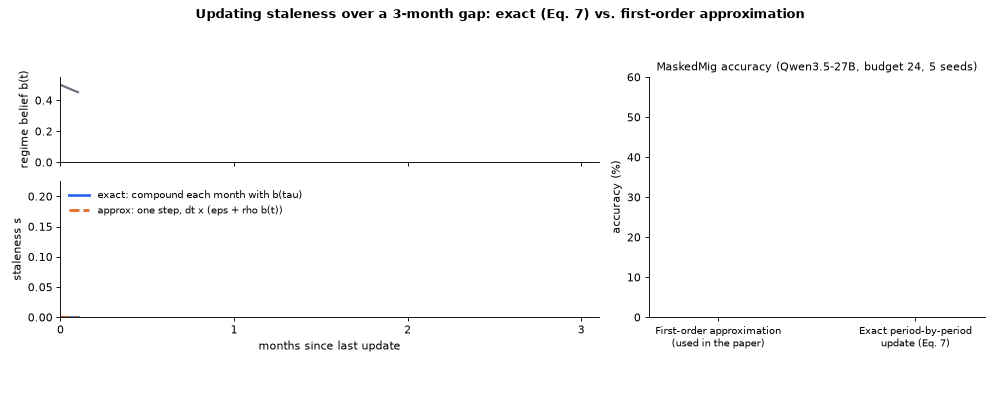

<h1 align="center">Reviewer 5Xuf · W2, Q2</h1>

<p align="center">
  
  
  
  
  
</p>

> [!NOTE]
> **Material for Reviewer 5Xuf, weakness 2 and question 2.** It adds the exact period-by-period staleness update of Eq. 7
> next to the first-order approximation that produced the paper's numbers, behind one configuration switch, plus the run
> script of the comparison. Code only; the comparison numbers below are quoted from the rebuttal.

## At a glance

| Reviewer's point | What this folder adds | Jump to |
|:---|:---|:---|
| **W2** `_touch_entry` multiplies the one-period hazard by the number of elapsed periods instead of composing it | `FilterConfig.compose_per_period = 1` applies Eq. 7 once per period with the regime belief of Eq. 5 at each step | [Code change](#what-changed-in-the-code) |
| **Q2** is this intentional, and how much does it change the results | a 5-seed MaskedMig comparison of both forms under the main-table protocol | [Response](#the-concern) |

---

## The concern

> **W2:** **Potential inconsistency between the paper and implementation.** Equation 7 and Appendix A.1 describe updating staleness period by period as the regime belief evolves. However, the released `_touch_entry` implementation appears to multiply the one-period hazard, evaluated using the final regime belief, by the number of elapsed periods.
>
> **Q2:** Is the multi-period update in `_touch_entry` an intentional approximation? How does it affect the results compared with the update described in the paper?

**Response.** Thank you for pointing it out. Your observation is correct. We made a first-order approximation in the implementation, and it affects the MaskedMig benchmark only. We did four things.

1. **We ran the exact period-by-period update** on MaskedMig, with the update exactly as written in the paper, under the main-table protocol (5 seeds):

   | (MaskedMig, Qwen3.5-27B, budget 24, 5 seeds) | Accuracy (%) |
   |:---|:---:|
   | Approximation (used in the paper) | `48.5 ± 2.2` |
   | Exact period-by-period update | `46.9 ± 4.0` |

   The two differ by only `1.6` points, well within the seed-to-seed variation (about `4` points), and make nearly the same maintenance decisions. Our conclusions are unchanged.

2. **We checked where the approximation matters.** On AcmeSDK the filter is updated every month, so each update is exactly one period and the two forms coincide. The approximation only affects MaskedMig, where each update spans one quarter (three months).

3. **We will revise the manuscript.** Eq. 7 and Appendix A.1 will describe the approximation actually used, and the comparison goes to the appendix.

4. **We release both versions.** This folder contains them, behind `compose_per_period`.

<p align="center"></p>

## What changed in the code

| File | Change |
|:---|:---|
| [`bayesian_harness/filters.py`](../../bayesian_harness/filters.py) | New `FilterConfig.compose_per_period` (default `0` = approximation, paper numbers). With `1`, `_touch_entry` calls `_compose_entry`, which applies Eq. 7 once per period with the regime belief `b(τ)` from Eq. 5 (`_b_at`). |
| [`scripts/run_maskedmig_w2_exact.sh`](../../scripts/run_maskedmig_w2_exact.sh) | Runs both versions on MaskedMig (budget 24, `--t-scale 3`, 5 seeds). |
| [`rebuttal/W2_exact/make_gif.py`](make_gif.py) | Draws the GIF above. |

<details>
<summary><strong>The two update rules side by side</strong></summary>

```python
# first-order form (paper numbers): one step over a gap of dt periods, belief taken at the end of the gap
h = eps * dt + sum(w_f * rho_f * dt * b_f(t) for f in parents)
s = s + (1 - s) * min(1, h)

# exact form (compose_per_period = 1): Eq. 7 once per period, belief advanced by Eq. 5 at each step
for tau in (t_last + 1, ..., t):
    h = eps + sum(w_f * rho_f * b_f(tau) for f in parents)
    s = s + (1 - s) * h
```

For dt = 1 (AcmeSDK, monthly) both rules are identical. For dt = 3 (MaskedMig, quarterly) they differ by the compounding of the one-period break probability.

</details>

## Reproduce

```bash
# both versions on MaskedMig, 5 seeds (needs a model server, see scripts/serve_vllm.sh, and the migration environments)
scripts/run_maskedmig_w2_exact.sh Qwen/Qwen3.5-27B "1 2 3 4 5"
# or, by hand, the exact form only
python3 maskedmig/masked_loop.py --conditions ours_hhmm --cfg compose_per_period=1 ...
```

## Other rebuttal material

Every branch starts from `main`, adds only what the reviewer asked for, and carries its own README.

| Branch | Reviewer | Points | Content |
|:---|:---:|:---:|:---|
| [`reviewer_5Xuf/W1_FactorRuleFilter`](https://github.com/anonymouspaper987/Bayesian_Harness/tree/reviewer_5Xuf/rebuttal/W1_FactorRuleFilter) | 5Xuf | W1, Q1 | `FactorRuleFilter` (sibling-propagation rule) under both main-table protocols, 36 run logs |
| [`reviewer_5Xuf/W2_exact`](https://github.com/anonymouspaper987/Bayesian_Harness/tree/reviewer_5Xuf/rebuttal/W2_exact) **(this folder)** | 5Xuf | W2, Q2 | exact period-by-period staleness update next to the first-order form used in the paper |
| [`reviewer_zpd8/Q1_failed_repair`](https://github.com/anonymouspaper987/Bayesian_Harness/tree/reviewer_zpd8/rebuttal/zpd8_Q1_failed_repair) | zpd8 | Q1 | what happens after a failed repair: reset (paper) vs. keep-as-broken-and-retry, 18 run logs |
| [`reviewer_zpd8/W1_two_counters`](https://github.com/anonymouspaper987/Bayesian_Harness/tree/reviewer_zpd8/rebuttal/zpd8_W1_two_counters) | zpd8 | W1, Q2 | two-counter policy under the MaskedMig main-table protocol, 9 run logs |
| [`reviewer_zpd8/W2_oracle_backoff`](https://github.com/anonymouspaper987/Bayesian_Harness/tree/reviewer_zpd8/rebuttal/zpd8_W2_oracle_backoff) | zpd8 | W2 | Oracle with back-off after a failed repair, 27 run logs |
| [`reviewer_TvTY/W1_release_signal`](https://github.com/anonymouspaper987/Bayesian_Harness/tree/reviewer_TvTY/rebuttal/TvTY_W1_release_signal) | TvTY | W1, Q1, Q2, Q3 | release-aware baseline (version bump / changelog), sensitivity sweep on the reviewer's grid, calibration data |
| [`reviewer_TvTY/W2_paired_tests`](https://github.com/anonymouspaper987/Bayesian_Harness/tree/reviewer_TvTY/rebuttal/TvTY_W2_paired_tests) | TvTY | W2, Q4, Q5, Q6 | paired McNemar tests for every main-table cell, low-quality-notes world, pointer to the Oracle ceiling |

The full code release and its documentation are on the [`main`](https://github.com/anonymouspaper987/Bayesian_Harness/tree/main) branch. The data (19 generated worlds, 157 masked migrations) is in the companion [bayesian_harness_datasets](https://github.com/anonymouspaper987/bayesian_harness_datasets) repository.
